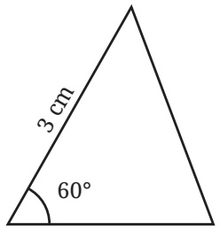
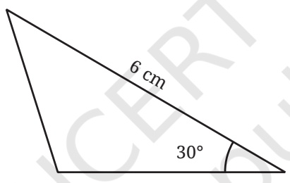
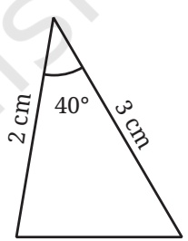
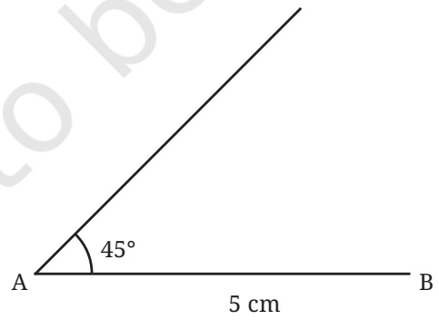
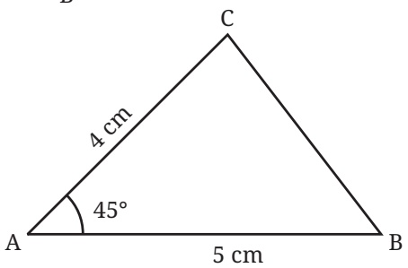

See if you can describe all possible lengths of the third side in each case, so that a triangle exists with those sidelengths. For example, in case (a), all numbers strictly between 99 and 101 would be possible.

## 7.3 Construction of Triangles When Some Sides and Angles are Given

We have seen how to construct triangles when their sidelengths are given. Now, we will take up constructions where in place of some sidelengths, angle measures are given.

## Two Sides and the Included Angle

How do we construct a triangle if two sides and the angle included between them are given? Here are some examples of measurements showing the included angle.

4 cm

Construct a triangle ABC with AB = 5 cm, AC = 4 cm and $\angle A = 45^{\circ}$

Let us take one of the given sides, AB, as the base of the triangle.

**Step 1:** Construct a side AB of length 5 cm.

**Step 2:** Construct $\angle \mathrm{A} = 45^{\circ}$ by drawing the other arm of the angle.

**Step 3:** Mark the point C on the other arm such that AC = 4 cm.

**Step 4:** Join BC to get the required triangle.

