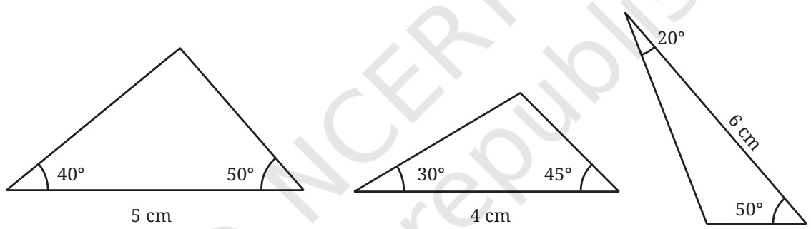
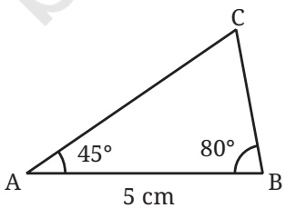
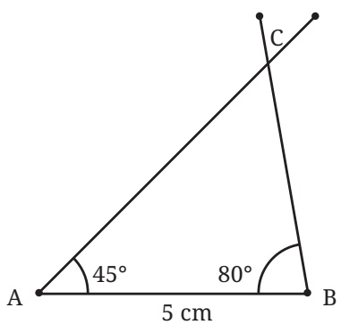

## Figure it Out

1. Construct triangles for the following measurements where the angle is included between the sides:

(a) 3 cm, 75°, 7 cm

(b) 6 cm, 25°, 3 cm

(c) 3 cm, $1 2 0 ^ { \circ } ,$ 8 cm

? We have seen that triangles do not exist for all sets of sidelengths. Is there a combination of measurements in the case of two sides M and the included angle where a triangle is not possible? Justify T your answer using what you observe during construction.

## Two Angles and the Included Side

In this case, we are given two angles and the side that is a part of both angles, which we call the included side. Here are some examples of such measurements:

Construct a triangle ABC where $\mathrm { A B } = 5$ cm, $\angle \mathrm{A} = 45^{\circ}$ and $\angle \mathrm{B} = 80^{\circ}$ Let us take the given side as the base.

**Step 1:** Draw the base AB of length 5 cm.

**Step 2:** Draw $\angle \mathrm { A }$ and $\angle \mathrm { B }$ of measures $4 5 ^ { \circ } ;$ , and $8 0 ^ { \circ }$ respectively.

**Step 3:** The point of intersection of the two new line segments is the third vertex C.

