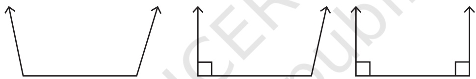
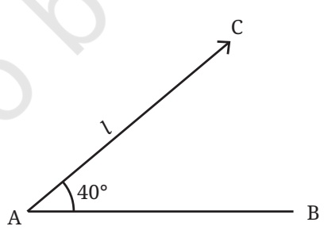

## Figure it Out

1. Construct triangles for the following measurements:

(a) 75°, 5 cm, 75°

(b) 25°, 3 cm, 60°

(c) 120°, 6 cm, 30°

## Do triangles always exist?

？ Do triangles exist for every combination of two angles and their included side? Explore.

As in the case when we are given all three sides, it turns out that there is not always a triangle for every combination of two angles and the included side.

Find examples of measurements of two angles with the included side where a triangle is not possible.

Let us try to visualise such a situation. Once the base is drawn, try to imagine how the other sides should be so that they do not meet.

Here are some obvious examples.

If the two angles are greater than or equal to a right angle (90°), then it is clear that a triangle is not possible.

Now we make one of the base angles an acute angle, say $4 0 ^ { \circ }$ . What are the possible values that the other angle should take so that the lines don’t meet?

? It is clear that if the line from B is “inclined” sufficiently to the right, then it will not meet the line l.

(a) Try to find a possible ∠B (marked in the figure) for this to happen.

(b) What could be smallest value of ∠B for the lines to not meet?