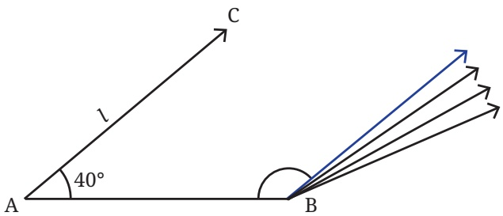

The blue line is the line with the least rightward bend that doesn’t meet the line $\bar { \mathcal { C } }$

Visually, it is clear that the line that creates the smallest $\angle \mathrm { B }$ has to be the one parallel to l. Let us call this parallel line m.

Can you tell the actual value of ∠B be in this case?

[**Hint:** Note that AB is the transversal.]

We have seen that when two lines are parallel, the internal angles on the same side of the transversal add up to $1 8 0 ^ { \circ }$ . So $\angle \mathrm{B} = 140^{\circ}.$

So, for what values of $\angle \mathrm { B } ,$ does a triangle not exist? Does the length AB play any part here?

From the discussion above, it can be seen that the length AB does not play any part in deciding the existence of a triangle. We can say that a triangle does not exist when $\angle \mathrm { B }$ is greater than or equal to $1 4 0 ^ { \circ }$

## Figure it Out

1. For each of the following angles, find another angle for which a triangle is (a) possible, (b) not possible. Find at least two different angles for each category:

(a) $3 0 ^ { \circ }$

(b) $7 0 ^ { \circ }$

(c) $5 4 ^ { \circ }$

(d) $1 4 4 ^ { \circ }$

2. Determine which of the following pairs can be the angles of a triangle and which cannot: (a) $3 5 ^ { \circ } , 1 5 0 ^ { \circ }$ (b) $70^{\circ},30^{\circ}$ (c) $90^{\circ} , 85^{\circ}$ (d) $5 0 ^ { \circ } , 1 5 0 ^ { \circ }$

？ Like the triangle inequality, can you form a rule that describes the two angles for which a triangle is possible?

Can the sum of the two angles be used for framing this rule?