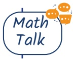
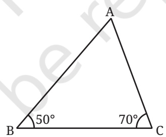
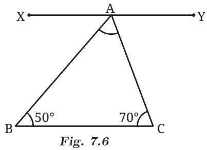

When the sum of two given angles is less than $1 8 0 ^ { \circ } ]$ , a triangle exists with these angles. If the sum is greater than or equal to $1 8 0 ^ { \circ }$ , there is no triangle with these angles.

Let us take two angles, say $6 0 ^ { \circ }$ and $7 0 ^ { \circ } ]$ , whose sum is less than $1 8 0 ^ { \circ }$ Let the included side be 5 cm.

? What could the measure of the third angle be? Does this measure change if the base length is changed to some other value, say 7 cm? Construct and find out.

？ In general, once the two angles are fixed, does the third angle depend on the included sidelength? Try with different pairs of angles and lengths.

The measurements might show that the sidelength has no effect (or a very small effect) on the third angle. With this observation, let us see if we can find the third angle without carrying out the construction and measurement.

? Try experimenting with different triangles to see if there is a relation between any two angles and the third one. To find this relation, what data will you keep track of and how will you organise the data you collect?

？ Consider a triangle ABC with $\angle B = 50^{\circ}$ and $\angle C = 70^{\circ}$ . Let us see how we can find $\angle \mathrm { A }$ without construction.

We saw that the notion of parallel lines was useful to determine that

the sum of any two angles of a triangle is less than $1 8 0 ^ { \circ } ,$ Parallel lines can be used to find the third angle, ∠BAC as well.

Let us suppose we construct a line XY parallel to BC through vertex A.

We can see new angles being formed here: ∠XAB, and $\angle \mathtt { Y A C } ,$ . What are their values?

Since the line XY is parallel to BC,

$\angle \mathrm{XAB} = \angle \mathrm{B}$ and $\angle \mathrm{YAC} = \angle \mathrm{C},$ , because they are alternate angles of the transversals AB and AC.