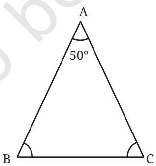

Therefore, $\angle \mathrm{XAB} = 50^{\circ}$ , and $\angle \mathrm{MAC} = 70^{\circ}$ . Can we find $\angle  BAC$ from this? We know that ∠XAB, ∠YAC and $\angle  BAC$ together form $1 8 0 ^ { \circ }$ . So

$$
\angle XAB + \angle YAC + \angle BAC = 180^{\circ}
$$

$$
50^{\circ}+\angle BAC+70^{\circ}=180^{\circ}
$$

$$
120^{\circ}+\angle BAC=180^{\circ}
$$

$$
\mathrm{Thus}, \angle \mathrm{BAC} = 60^{\circ}
$$

Now construct a triangle (taking BC to be of any suitable length) and verify if this is indeed the case.

## Figure it Out

1. Find the third angle of a triangle (using a parallel line) when two of the angles are:

(a) $3 6 ^ { \circ } , 7 2 ^ { \circ }$

(b) $1 5 0 ^ { \circ } , 1 5 ^ { \circ }$

$9 0 ^ { \circ } ,   3 0 ^ { \circ }$

(d) $7 5 ^ { \circ } , 4 5 ^ { \circ }$

2. Can you construct a triangle all of whose angles are equal to $7 0 ^ { \circ } ?$ If two of the angles are $7 0 ^ { \circ }$ what would the third angle be? If all the angles in a triangle have to be equal, then what must its measure be? Explore and find out.

3. Here is a triangle in which we know $\angle \mathbf{B} = \angle \mathbf{C}$ and $\angle A = 50^{\circ}.$ Can you find ∠B and $\angle C ?$

## Angle Sum Property

？ What can we say about the sum of the angles of any triangle?

Consider a triangle ABC. To find the sum of its angles, we can use the same method of drawing a line parallel to the base: construct a line through A that is parallel to BC.