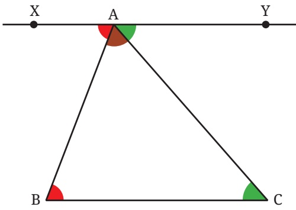
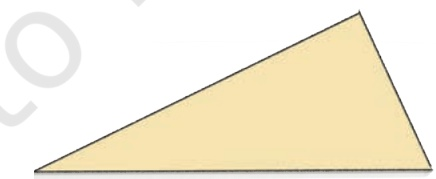
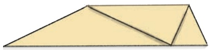
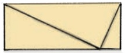

We need to find $\angle \mathrm{A} + \angle \mathrm{B} + \angle \mathrm{C}$

We know that $\angle \mathrm{B} = \angle \mathrm{XAB} , \angle \mathrm{C} = \angle \mathrm{YAC} .$

So, $\angle \mathrm{A} + \angle \mathrm{B} + \angle \mathrm{C} = \angle \mathrm{A} + \angle \mathrm{XAB} + \angle \mathrm{YAC}$ $= 1 8 0 ^ { \circ }$ as together they form a straight angle.

Thus we have proved that the sum of the three angles in any triangle is $1 8 0 ^ { \circ } !$ This rather surprising result is called the **angle sum property of triangles**.

Fig. 7.7

Take some time to reflect upon how we figured out the angle sum property. In the beginning, the relationship between the third angle and the other two angles was not at all clear. However, a simple idea of drawing a line parallel to the base through the top vertex (as in Fig.  7.7) suddenly made the relationship obvious. This ingenious idea can be found in a very influential book in the history of mathematics called ‘The Elements’. This book is attributed to the Greek mathematician Euclid, who lived around 300 BCE.

This solution is yet another example of how creative thinking plays a key role in mathematics!

There is a convenient way of verifying the angle sum property by folding a triangular cut-out of a paper. Do you see how this shows that the sum of the angles in this triangle is 180°?

