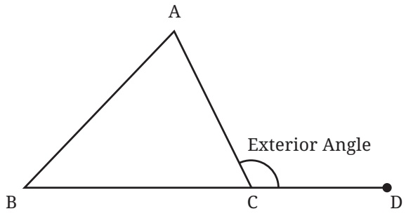
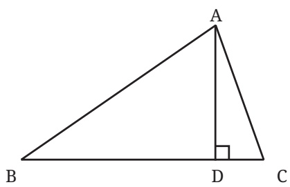

## Exterior Angles

The angle formed between the extension of a side of a triangle and the other side is called an **exterior angle** of the triangle. In this figure, $\angle  ACD$ is an exterior angle.

Find $\angle  ACD ,$ , if $\angle \mathrm{A} = 50^{\circ}$ , and $\angle \mathrm{B} = 60^{\circ}$

From the angle sum property, we know that

$$
50^{\circ}+60^{\circ}+\angle ACB=180^{\circ}
$$

$$
110^{\circ}+\angle ACB=180^{\circ}
$$

So, $\angle ACB = 70^{\circ}$

So, $\angle ACD = 180^{\circ} - 70^{\circ} = 110^{\circ},$

since, $\angle \mathrm { A C B }$ and $\angle  ACD$ together form a straight angle. Find the exterior angle for different measures of $\angle \mathrm { A }$ and $\angle \mathrm { B }$ . Do you see any relation between the exterior angle and these two angles? **[Hint:** From angle sum property, we have $\angle \mathrm{A} + \angle \mathrm{B} + \angle \mathrm{ACB} = 180^{\circ}.$ We also have $\angle ACD + \angle ACB = 180^{\circ}$ , since they form a straight angle. What does this show?

## 7.4 Constructions Related to Altitudes of Triangles

There is another set of useful measurements with respect to a triangle the height of each of its vertices with respect to the opposite sides.

In the world around us, we talk of the heights of various objects: the height of a person, the height of a tree, the height of a building, etc. What do we mean by the word ‘height’?

Consider a triangle ABC. What is the height of the vertex A from its opposite side BC, and how can it be measured?

Fig. 7.8

Let AD be the line segment from A drawn perpendicular to BC. The length of AD is the height of the vertex A from BC. The line segment AD is said to be one of the ‘altitudes’ of the triangle. The other altitudes