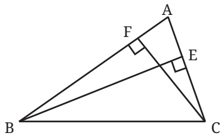
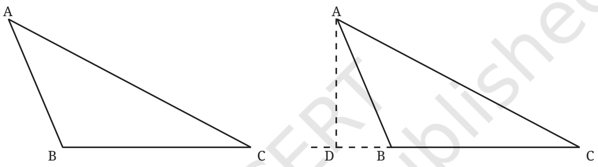

are BE and CF in the figure below: the perpendiculars drawn from the other vertices to their respective opposite sides.

Whenever we use the word height of the triangle, we generally refer to the length of the altitude to whatever side we take as base (this altitude is AD in the case of Fig. 7.8).

What would the altitude from A to BC be in this triangle?

We extend BC and then drop the perpendicular from A to this line.

## Altitudes Using Paper Folding

Cut out a paper triangle. Fix one of the sides as the base. Fold it in such a way that the resulting crease is an altitude from the top vertex to the base. Justify why the crease formed should be perpendicular to the base.

## Construction of the Altitudes of a Triangle

Construct an arbitrary triangle. Label the vertices A, B, C taking BC to be the base.

## Construct the altitude from A to BC,

Constructing the altitude using just a ruler is not accurate. To get a more precise angle of 90°, we use a set square along with a ruler.

## Can you see how to do this?