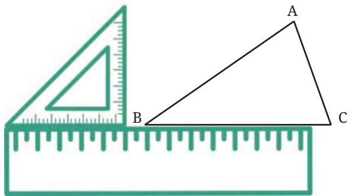
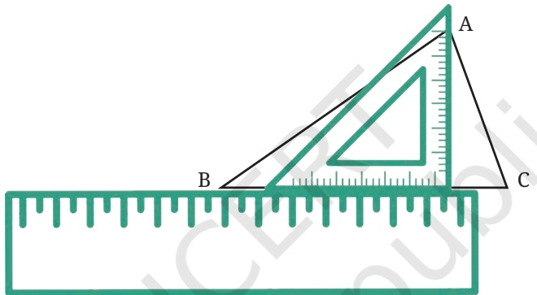
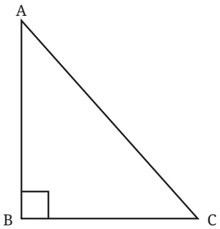

**Step 1:** Keep the ruler aligned to the base. Place the set square on the ruler as shown, such that one of the edges of the right angle touches the ruler.

Step 2: Slide the set square along the ruler till the vertical edge of the set square touches the vertex A. dte

**Step 3:** Draw the altitude to BC through A using the vertical edge of the set square.

Does there exist a triangle in which a side is also an altitude?

Visualise such a triangle and draw a rough diagram.

We see that this happens in triangles where one of the angles is a right angle.

Triangles having one right angle are called **right-angled triangles** or simply **right triangles**.

Altitude from A to BC

