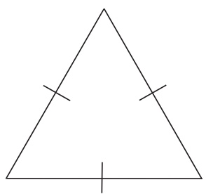
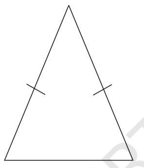
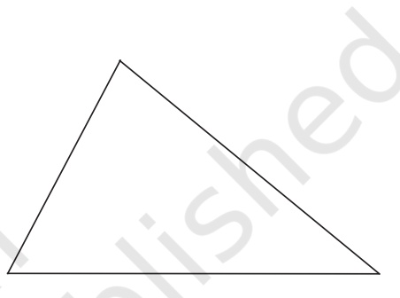

## 7.5 Types of Triangles

In our study of triangles, we have encountered the following types of triangles; equilateral, isosceles, scalene and right-angled triangles.

## Did you spot any other type of triangle?

The classification of triangles as equilateral and isosceles was based on equality of sides.

Equilateral triangles have sides of equal length. Isosceles triangles have two sides of equal length. Scalene triangles have sides of three different lengths.

Equilateral Triangle Equilateral Triangle

Isosceles Triangle Isosceles Triangle

Scalene Triangle Scalene Triangle

Can a similar classification be done based on equality of angles? Is there any relation between these two classifications? We will answer these questions in a later chapter.

We used angle measures when classifying a triangle as a rightangled triangle.

## ? What are the other types of triangles based on angle measures?

A classification of triangles based on their angle measures is acuteangled, right-angled and obtuse-angled triangles. We have already seen what a right-angled triangle is. It is a triangle with one right angle. Similarly, an obtuse-angled triangle has one obtuse angle.

What could an acute-angled triangle be? Can we define it as a triangle with one acute angle? Why not?

In an **acute-angled** triangle, all three angles are acute angles.

## Figure it Out

1. Construct a triangle ABC with BC = 5 cm, AB = 6 cm, CA = 5 cm. Construct an altitude from A to BC.

2. Construct a triangle TRY with RY = 4 cm, TR = 7 cm, $\angle \mathrm{R} = 140^{\circ}$ Construct an altitude from T to RY.