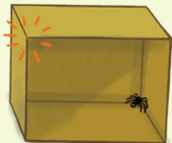
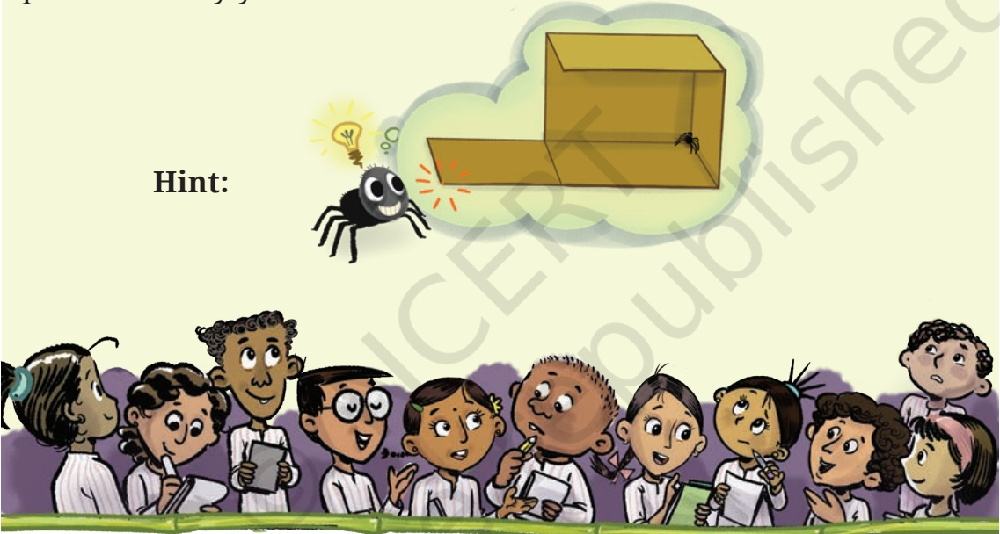

## IT's PUZZLE TIME!

# Shortest Path in a Box!

There is a spider in a corner of a box. It wants to reach the farthest

opposite corner (marked in the figure). Since it cannot fly, it can reach the opposite point only by walking on the surfaces of the box. What is the shortest path it can take?

Take a cardboard box and mark the path that you think is the shortest from one corner to its

opposite corner. Compare the length of this path with that of the paths made by your friends.

**Hint:**

