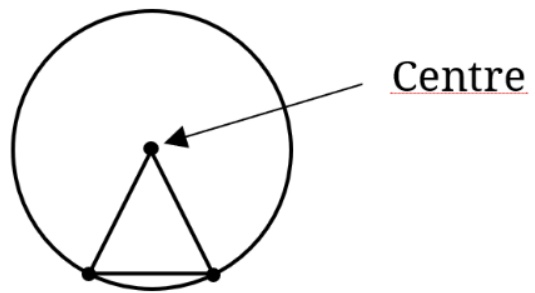
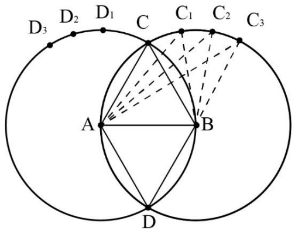
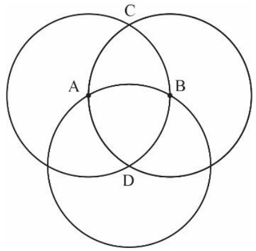

## Page No. 150

？ **Figure it out**

**1. Use the points on the circle and/or the centre to form isosceles triangles.**

**Ans:** One Such diagram is Try more

**Page No. 151**

**2. Use the points on the circles and/or their centres to form isosceles and equilateral triangles. The circles are of the same size.**

**Ans:**

Take points $\mathrm{C}, \mathrm{C}_{1}, \mathrm{C}_{2}, \mathrm{C}_{3} \ldots$ on the circle with centre B. The triangles ABC, $\mathrm{AC_{1}B, AC_{2}B, \cdots}$ are isosceles triangle. Similarly for points $\mathrm{D}_{1}, \mathrm{D}_{2}, \mathrm{D}_{3} \ldots \Delta \mathrm{ADB},$ $\Delta \mathrm{AD}_{1}\mathrm{B},\Delta \mathrm{AD}_{2}\mathrm{B},\ldots$ are isosceles triangles.

$\Delta \mathrm { A B C }$ and $\Delta \mathrm { A D B }$ are equilateral triangle.

Similarly it can be done for the other figure.