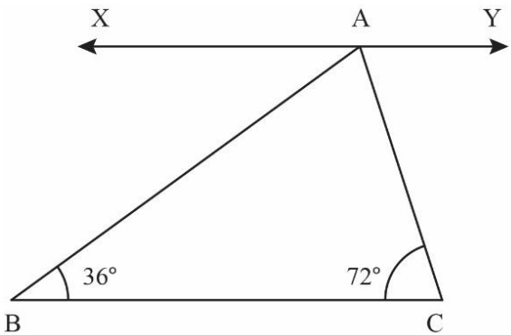

？ **Like the triangle inequality, can you form a rule that describes the two angles for which a triangle is possible?**

**Ans**: Rules for two angles A and B to form a triangle is $0^{\circ} <  A  +  B  < 180^{\circ}$

**Page No. 165**

？ **Figure it out**

**1. Find the third angle of a triangle (using a parallel line) when two of the angles are:**

**Process for (a) is given. Try for rest.**

(a) $\mathbf { 3 6 ^ { \circ } } , 7 2 ^ { \circ }$

**Ans:**Consider $\Delta \mathrm { A B C } ,$ , Draw line XY parallel to line BC so AB and AC become transversals.

Therefore $\angle XAB = \angle B = 36^{\circ}$ and $\angle YAC = \angle C = 72^{\circ}$ (Alternate Angles)

On line XY —

$$
\angle XAB + \angle BAC + \angle YAC = 180^{\circ}
$$

So,  BAC = 72°

(b) $\mathbf { 1 5 0 ^ { \circ } } , \mathbf { 1 5 ^ { \circ } }$

**Ans:** $1 5 ^ { \circ }$

(c) $\mathbf { 9 0 ^ { \circ } , 3 0 ^ { \circ } }$

**Ans:** $6 0 ^ { \circ }$

(d) $7 5 ^ { \circ } , 4 5 ^ { \circ }$

**Ans:** 60°