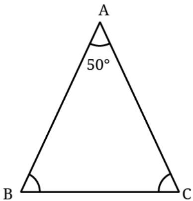

**2. Can you construct a triangle all of whose angles are equal to** $7 0 ^ { \circ } ?$ **If two of the angles are** $7 0 ^ { \circ }$ **what would the third angle be? If all the angles in a triangle have to be equal, then what must its measure be? Explore and find out.**

**Ans:**

$\mathbf { N o } ,$ such triangle is not possible.

$4 0 ^ { \circ }$

$6 0 ^ { \circ }$

**3. Here is a triangle in which we know,**

$\angle \mathbf{B} = \angle \mathbf{C}$ and $\angle \mathbf{A} = 50^{\circ}$ . Can you find $\angle \mathbf { B }$ and $\angle C ?$

**Ans:** $\angle B = \angle C = 65^{\circ}$