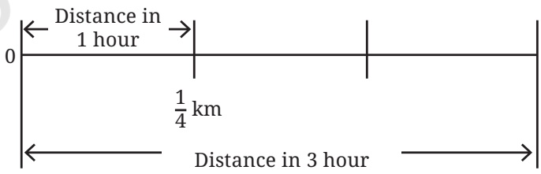

# 8 WORKING WITH FRACTIONS

0774CH08

## 8.1 Multiplication of Fractions

Aaron walks 3 kilometres in 1 hour. How far can he walk in 5 hours?

This is a simple question. We know that to find the distance, we need to find the product of 5 and 3, i.e., we multiply 5 and 3.

Distance covered in 1 hour = 3 km.

Therefore,

Distance covered in 5 hours

$$
= 5 \times 3    km
$$

$$
3+3+3+3+3 \mathrm{km}
$$

## = 15 km.

？ Aaron’s pet tortoise walks at a much slower pace. It can walk only $\frac { 1 } { 4 }$ kilometre in 1 hour. How far can it walk in 3 hours?

Here, the distance covered in an hour is a fraction. This does not matter. The total distance covered is calculated in the same way, as multiplication.

Distance covered in 1 hour $= { \frac { 1 } { 4 } }$ km.