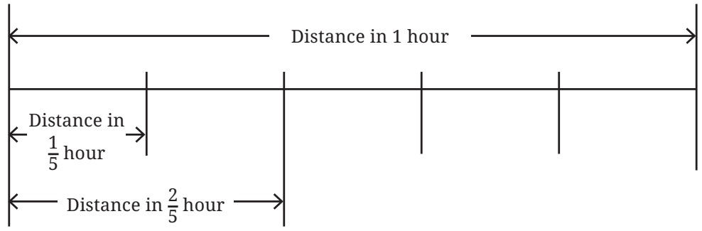
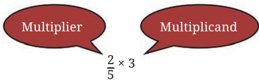

Once again, we have —

Distance covered $= { \frac { 2 } { 5 } } \times 3$ km.

**Finding the product:**

1. We can first find the distance covered in $\frac { 1 } { 5 }$ hours.

2. Since, the duration $\frac{2}{5}$ is twice ${ \frac { 1 } { 5 } } ,$ we multiply this distance by 2 to get the total distance covered.

Here is the calculation.

Distance covered in 1 hour = 3 km.

1. Distance covered in $\frac { 1 } { 5 }$ hour

= The length we get by dividing 3 km in 5 equal parts $= \frac{3}{5}$ km.

2. Multiplying this distance by 2, we get

$$
2 \times \frac{3}{5} = \frac{6}{5}    km .
$$

From this we can see that

$$
{ \frac { 2 } { 5 } } \times 3 = { \frac { 6 } { 5 } } .
$$

## Discussion

We did this multiplication as follows:

• First, we divided the multiplicand, 3 , by the denominator of the multiplier, 5, to get ${ \frac { 3 } { 5 } } .$

