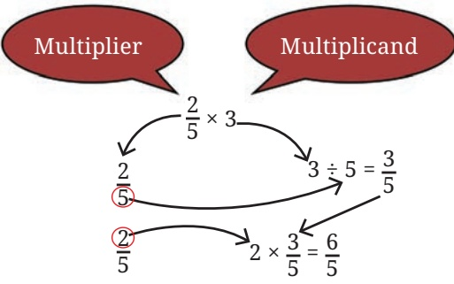

• We then multiplied the result by the numerator of the multiplier, that is 2, to get ${ \frac { 6 } { 5 } } .$ Multiplier Multiplicand

Thus, whenever we need to multiply a fraction and a whole number, we follow the steps above.

**Example 1:** A farmer had 5 grandchildren. She distributed $\frac { 2 } { 3 }$ acre of land to each of her grandchildren.

How much land in all did she give to her grandchildren?

$$
5 \times \frac{2}{3} = \frac{2}{3} + \frac{2}{3} + \frac{2}{3} + \frac{2}{3} + \frac{2}{3} = \frac{10}{3}.
$$

? **Example 2:** 1 hour of internet time costs ₹8. How much will 1 $\frac{1}{4}$ hours of internet time cost?

1 $\frac { 1 } { 4 }$ hours is $\frac { 5 } { 4 }$ hours (converting from a mixed fraction).

Cost of $\frac { 5 } { 4 }$ hour of internet time $\begin{aligned}&=\frac{5}{4} \times 8 \\&= 5 \times \frac{8}{4} \\&= 5 \times 2 \\&= 10.\end{aligned}$

It costs ₹10 for $1 { \frac { 1 } { 4 } }$ hours of internet time.

## Figure it Out

1. Tenzin drinks $\frac { 1 } { 2 }$ glass of milk every day. How many glasses of milk does he drink in a week? How many glasses of milk did he drink in the month of January?

2. A team of workers can make 1 km of a water canal in 8 days. So, in one day, the team can make \_\_\_ km of the water canal. If they work 5 days a week, they can make \_\_\_ km of the water canal in a week.

3. Manju and two of her neighbours buy 5 litres of oil every week and share it equally among the 3 families. How much oil does each family get in a week? How much oil will one family get in 4 weeks?

4. Safia saw the Moon setting on Monday at 10 pm. Her mother, who is a scientist, told her that every day the Moon sets $\frac{5}{6}$ hour later than