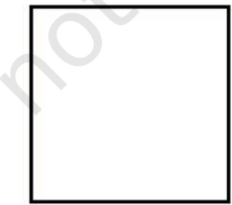
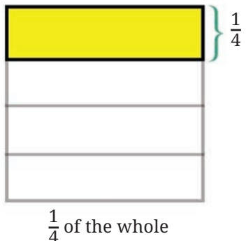

the previous day. How many hours after 10 pm will the moon set on Thursday?

5. Multiply and then convert it into a mixed fraction:

(a) $7 \times \frac { 3 } { 5 }$ (b) $4 \times { \frac { 1 } { 3 } }$ (c) $\frac { 9 } { 7 } \times 6$ (d) $\frac { 1 3 } { 1 1 } \times 6$

So far, we have learnt multiplication of a whole number with a fraction, and a fraction with a whole number. What happens when both numbers in the multiplication are fractions?

## Multiplying Two Fractions

We know, that Aaron’s pet tortoise can walk only $\frac { 1 } { 4 }$ km in 1 hour. How far can it walk in half an hour?

Following our approach of using multiplication to solve such problems, we have,

Distance covered in $\frac{1}{2} \text { hour } = \frac{1}{2} \times \frac{1}{4}$ km.

## Finding the product:

<table><tbody><tr><td>Hour</td><td>Distance</td></tr><tr><td rowspan="2">1</td><td rowspan="2">14</td></tr><tr></tr><tr><td rowspan="2">12</td><td rowspan="2">?</td></tr><tr></tr></tbody></table>

Distance covered in 1 $\mathrm{h0ur} = \frac{1}{4} \mathrm{km}.$

Therefore, the distance covered in $\frac { 1 } { 2 }$ an hour is the length we get by dividing $\frac { 1 } { 4 }$ into 2 equal parts.

To find this, it is useful to represent fractions using the unit square to stand for a “whole”.

Unit square as a “whole”

