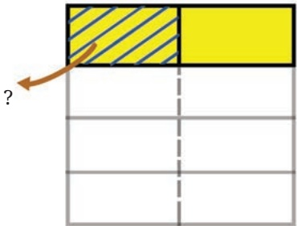
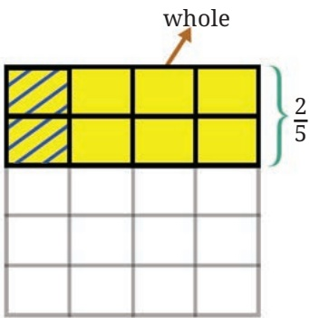

Now we divide this $\frac { 1 } { 4 }$ into 2 equal parts. What do we get? What fraction of the whole is shaded?

$\frac { 1 } { 4 }$ divided into 2 equal parts

Since the whole is divided into 8 equal parts and one of the parts is shaded, we can say that $\frac { 1 } { 8 }$ of the whole is shaded. So, the distance covered by the tortoise in half an hour is $\frac { 1 } { 8 }$ km.

This tells us that ${ \frac { 1 } { 2 } } \times { \frac { 1 } { 4 } } = { \frac { 1 } { 8 } } .$

? If the tortoise walks faster and it can cover $\frac{2}{5}$ km in 1 hour, how far will it walk in $\frac { 3 } { 4 }$ of an hour?

Distance covered $= { \frac { 3 } { 4 } } \times { \frac { 2 } { 5 } } .$

**Finding the product:**

(i) First find the distance covered in $\frac { 1 } { 4 }$ of an hour.

(ii) Multiply the result by 3, to get the distance covered in $\frac { 3 } { 4 }$ of an hour.

(i) Distance in km covered in $\frac { 1 } { 4 }$ of an hour = The quantity we get by dividing $\frac{2}{5}$ into 4 equal parts.

Taking the unit square as the whole, the shaded part (in Fig. 8.1) is a region we get when we divide $\frac{2}{5}$ into 4 equal parts.

How much of the whole is it? The whole is divided into 5 rows and 4 columns, creating $5 \times 4 = 2 0$ equal parts.

Fig. 8.1

Number of these parts shaded = 2.

So, the distance covered in $\frac { 1 } { 4 }$ of an hour $c = { \frac { 2 } { 2 0 } }$