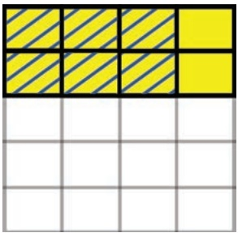
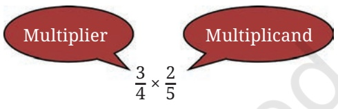
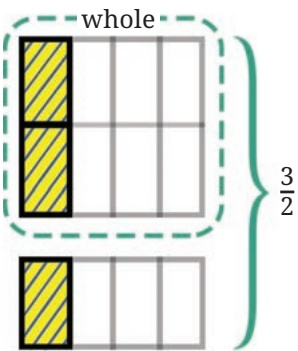

(ii) Now, we need to multiply $\frac { 2 } { 2 0 }$ by 3. Distance covered in $\frac { 3 } { 4 }$ of an hour $= 3 \times { \frac { 2 } { 2 0 } }$ $= { \frac { 6 } { 2 0 } }$ So, $\frac{3}{4} \times \frac{2}{5} = \frac{6}{20} = \frac{3}{10}.$

## Discussion

In the case of a fraction multiplied by another fraction, we follow a method similar to the one we used, when we multiplied a fraction by a whole number. We multiplied as follows:

Multiplier

Multiplicand

4 $\frac { 2 } { 5 } \div 4 = \frac { 2 } { 2 0 }$ Divide the multiplicand by 4. 34 $\frac{3}{3} \times \frac{2}{20} = \frac{6}{20} =$ Divide the multiplicand by 3.

Using this understanding, multiply ${ \frac { 5 } { 4 } } \times { \frac { 3 } { 2 } } .$

First, let us represent $\frac{3}{2},$ taking the unit square as the whole. Since, the fraction $\frac { 3 } { 2 }$ is one whole and a half, it can be seen as follows:

Following the steps of multiplication, we need to first divide this fraction $\frac{3}{2}$ into 4 equal parts. It can be done as shown in the Fig. 8.2 with the yellow shaded region representing the fraction obtained by dividing $\frac { 3 } { 2 }$ into 4 equal parts. What is its value?

Fig. 8.2

We see that the whole is divided into — 2 rows and 4 columns, creating $2 \times 4 = 8$ equal parts. Number of parts shaded = 3. So the yellow shaded part $= { \frac { 3 } { 8 } } .$