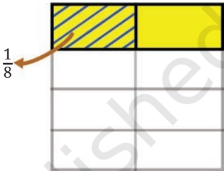

Now, the next step is multiplying this result by 5. This gives the product of $\frac { 5 } { 4 }$ and $\frac { 3 } { 2 } ;$

$$
\frac{5}{4} \times \frac{3}{2} = 5 \times \frac{3}{8} = \frac{15}{8}.
$$

## Connection between the Area of a Rectangle and Fraction Multiplication

In the Fig. 8.3, what is the length and breadth of the shaded rectangle? Since we started with a unit square (of side 1 unit), the length and

breadth are $\frac { 1 } { 2 }$ unit and $\frac { 1 } { 4 }$ unit.

What is the area of this rectangle? We see that 8 such rectangles give the square of area 1 square unit. So, the area of each rectangle is $\frac { 1 } { 8 }$ square units.

Do you see any relation between the area and the product of length and breadth?

Fig. 8.3

The area of a rectangle of fractional sides equals the product of its sides.

In general, if we want to find the product of two fractions, we can find the area of the rectangle formed with the two fractions as its sides.

## Figure it Out

1. Find the following products. Use a unit square as a whole for representing the fractions:

(a) $\frac { 1 } { 3 } \times \frac { 1 } { 5 }$ (b) $\frac { 1 } { 4 } \times \frac { 1 } { 3 }$ (c) $\frac{1}{5} \times \frac{1}{2}$ (d) $\frac{1}{6} \times \frac{1}{5}$

Now, find $\frac { 1 } { 1 2 } \times \frac { 1 } { 1 8 }$