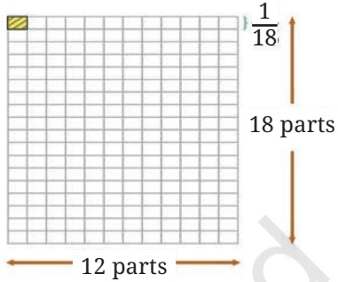
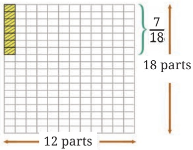

Doing this by representing the fractions using a unit square is cumbersome. Let us find the product by observing what we did in the above cases.

In each case, the whole is divided into rows and columns.

The number of rows is the denominator of the multiplicand, which is 18 in this case.

The number of columns is the denominator of the multiplier, which is 12 in this case.

Thus, the whole is divided into 18 × 12 equal parts.

So, $\frac{1}{18} \times \frac{1}{12} = \frac{1}{(18 \times 12)} = \frac{1}{216}$

Thus, when two fractional units are multiplied, their product is

## 1 (product of denominators).

We express this as:

$$
\frac{1}{b} \times \frac{1}{d} = \frac{1}{b \times d}.
$$

2. Find the following products. Use a unit square as a whole for representing the fractions and carrying out the operations. (a) $\frac { 2 } { 3 } \times \frac { 4 } { 5 }$ (b) $\frac { 1 } { 4 } \times \frac { 2 } { 3 }$ (c) $\frac { 3 } { 5 } \times \frac { 1 } { 2 }$ (d) $\frac{4}{6} \times \frac{3}{5}$

## Multiplying Numerators and Denominators

Now, find $\frac { 5 } { 1 2 } \times \frac { 7 } { 1 8 } .$

Like the previous case, let us find the product by performing the multiplication, step by step. First, the whole is divided into 18 rows and 12 columns creating 12 × 18 equal parts.

The value we get by dividing $\frac { 7 } { 1 8 }$ into 12 equal parts is $\frac { 7 } { ( 1 2 \times 1 8 ) }$

