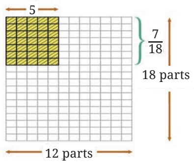

Then, we multiply this result by 5 to get the product. This is $\frac { ( 5 \times 7 ) } { ( 1 2 \times 1 8 ) } \cdot$

$$
\frac{5}{12} \times \frac{7}{8} = \frac{(5 \times 7)}{(12 \times 18)} = \frac{35}{216}
$$

From this we can see that, in general,

$$
\frac{a}{b} \times \frac{c}{d} = \frac{a \times c}{b \times d}.
$$

This formula was first stated in this general form by Brahmagupta in his Brāhmasphuṭasiddhānta in 628 CE.

The formula above works even when the multiplier or multiplicand fraction with denominator 1. For example,

$$
\frac{3 \times \frac{3}{4}  can be written  \frac{3}{1} \times \frac{3}{4}}{= \frac{3 \times 3}{1 \times 4} = \frac{9}{4}.}
$$

**Multiplication of Fractions — Simplifying to Lowest Form**

？ Multiply the following fractions and express the product in its lowest form:

$$
\frac { 1 2 } { 7 } \times \frac { 5 } { 2 4 }
$$

Instead of multiplying the numerators (12 and 5) and denominators (7 and 24) first and then simplifying, we could do the following:

$$
\frac{12}{7} \times \frac{5}{24} = \frac{\textcircled{1} \times 5}{7 \times \textcircled{2}}
$$

We see that both the circled numbers have a common factor of 12. We know that a fraction remains the same when the numerator and denominator are divided by the common factor. In this case, we can divide them by 12.