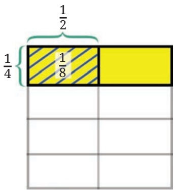
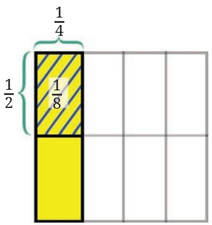
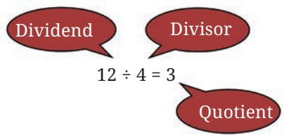

**Order of Multiplication**

We know that ${ \frac { 1 } { 2 } } \times { \frac { 1 } { 4 } } = { \frac { 1 } { 8 } } .$

Now, what is $\frac{1}{4} \times \frac{1}{2} ;$ That is $\frac{1}{8}$ too.

In general, note that the area of a rectangle remains the same even if the length and breadth are interchanged.

The order of multiplication does not matter. Thus,

$$
\frac{a}{b} \times \frac{c}{d} = \frac{c}{d} \times \frac{a}{b}.
$$

This can also be seen from Brahmagupta’s formula for multiplying fractions.

## 8.2 Division of Fractions

What is $12 \div 4?$ You know this already. But can this problem be restated as a multiplication problem?

What should be multiplied by 4 to get 12? That is,

$$
4 \times ? = 1 2
$$

