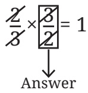
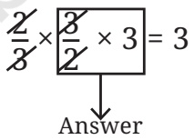

We can use this technique of converting division into multiplication problems to divide fractions.

What is $1 \div \frac { 2 } { 3 } ?$

Let us rewrite this as a multiplication problem

$$
\frac { 2 } { 3 } \times ? = 1
$$

What should be multiplied by $\frac{2}{3}$ to get the product 1?

If we somehow cancel out the 2 and the 3, we are left with 1.

So,

$$
1 \div \frac{2}{3} = \frac{3}{2}.
$$

Let us try another problem:

$$
3 \div \frac{2}{3}.
$$

This is the same as

$$
\frac{2}{3} \times 2 = 3.
$$

Can you find the answer?

We know what to multiply $\frac{2}{3}$ by to get 1. We just need to multiply that by 3 to get 3. So,

So,

$$
3 \div \frac{2}{3} = \frac{3}{2} \times 3 = \frac{9}{2}.
$$

What is 1 1 ? 5 2

Rewriting it as a multiplication problem, we have

$$
{ \frac { 1 } { 2 } } \times ? = { \frac { 1 } { 5 } } .
$$