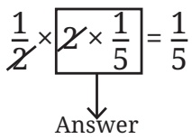
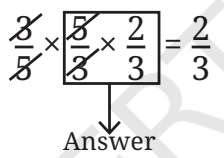
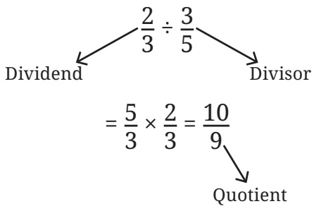

How do we solve this?

So,

$$
\frac{1}{5} \div \frac{1}{2} = 2 \times \frac{1}{5} = \frac{2}{5}.
$$

What is $\frac { 2 } { 3 } \div \frac { 3 } { 5 } ?$

Rewriting this as multiplication, we have

$$
{ \frac { 3 } { 5 } } \times ? = { \frac { 2 } { 3 } } .
$$

How will we solve this?

So,

$$
\frac{2}{3} \div \frac{3}{5} = \frac{5}{3} \times \frac{2}{3} = \frac{10}{9}.
$$

## Discussion

In each of the division problems above, observe how we found the answer. Can we frame a rule that tells us how to divide two fractions?

Let us consider the previous problem.

In every division problem we have a dividend, divisor and quotient. The technique we have been using to get the quotient is:

1. 	First, find the number which gives 1 when multiplied by the divisor. We see that the resulting number is a fraction whose numerator is the divisor’s denominator and denominator is the divisor’s numerator. For the divisor $\frac{3}{5}$ this fraction is ${ \frac { 5 } { 3 } } .$ We call $\frac { 5 } { 3 }$ the reciprocal of $\frac{3}{5},$ When we multiply a fraction by its reciprocal, we get 1. So, the first step in our technique is to find the divisor’s reciprocal.

