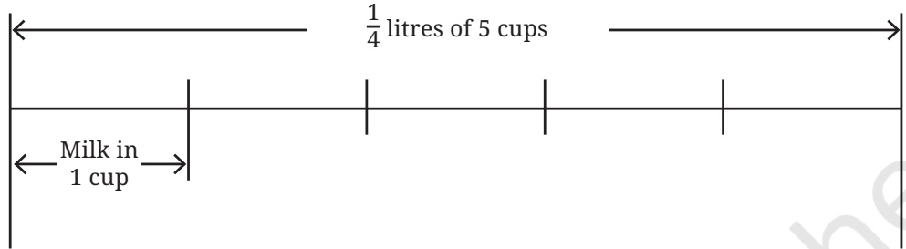

Use your understanding of such relationships in multiplication to answer the questions above.

## 8.3 Some Problems Involving Fractions

？ **Example 3:** Leena made 5 cups of tea. She used $\frac { 1 } { 4 }$ litre of milk for this. How much milk is there in each cup of tea?

Leena used $\frac { 1 } { 4 }$ litres of milk in 5 cups of tea. So, in 1 cup of tea the volume of milk should be:

$$
\frac{1}{4} \div 5.
$$

Writing this as multiplication, we have:

$$
5 \times ( \mathrm{mink} \mathrm{per} \mathrm{cap} ) = \frac{1}{4}.
$$

We perform the division as follows as per Brahmagupta’s method:

The reciprocal of 5 (the divisor) is $\frac{1}{5},$

Multiplying this reciprocal by the dividend $( \frac { 1 } { 4 } ) ,$ , we get

$$
\frac { 1 } { 5 } \times \frac { 1 } { 4 } = \frac { 1 } { 2 0 } .
$$

So, each cup of tea has $\frac { 1 } { 2 0 }$ litre of milk.

**Example 4:** Some of the oldest examples of working with non-unit fractions occur in humanity’s oldest geometry texts, the Śhulbasūtra. Here is an example from Baudhāyana’s Śhulbasūtra (c. 800 BCE).

Cover an area of 7 $\frac { 1 } { 2 }$ square units with square bricks each of whose sides is $\frac { 1 } { 5 }$ units.