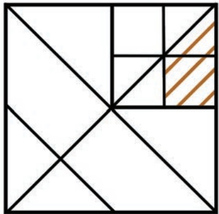
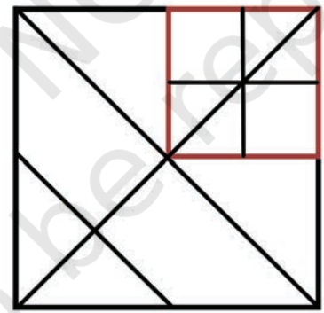
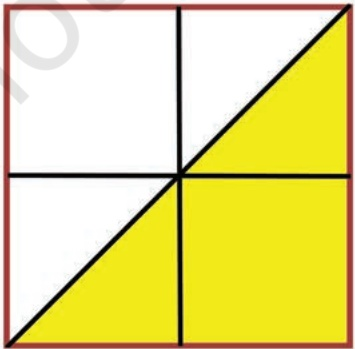
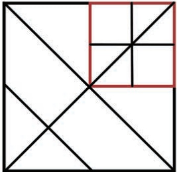

## Fractional Relations

Here is a square with some lines drawn inside.

Fig. 8.4

What fraction of area of the whole square does the shaded region occupy?

There are different ways to solve this problem. Here is one of them: Let the area of the whole square be 1 square unit.

We can see that the top right square (in Fig. 8.5), occupies $\frac { 1 } { 4 }$ of the area of the whole square.

Fig. 8.5

Area of red square $= \frac { 1 } { 4 }$ square units.

Fig, 8.6

