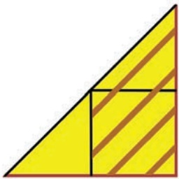
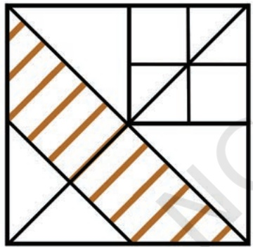
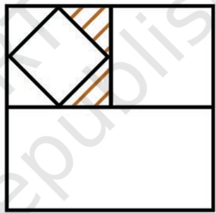

Let us look at this red square. The area of the triangle inside it (coloured yellow) is half the area of the red square. So,

the area of the yellow triangle $= { \frac { 1 } { 2 } } \times { \frac { 1 } { 4 } } = { \frac { 1 } { 8 } }$ square units.

What fraction of this yellow triangle is shaded?

The shaded region occupies $\frac { 3 } { 4 }$ of the area of the yellow triangle. Are you able to see why?

The area of shaded part $\frac{3}{4} \times \frac{1}{8} = \frac{3}{32}$ square units.

Thus, the shaded region occupies $\frac { 3 } { 3 2 }$ of the area of the whole square.

？ In each of the figures given below, find the fraction of the big square that the shaded region occupies.

We will solve more interesting problems of this kind in a later chapter.

## A Dramma-tic Donation

The following problem is translated from Bhāskarāchārya’s (Bhāskara II’s) book, Līlāvatī, written in 1150 CE.

“O wise one! A miser gave to a beggar $\frac { 1 } { 5 }$ of $\frac { 1 } { 1 6 }$ of $\frac { 1 } { 4 }$ of $\frac { 1 } { 2 }$ of $\frac{2}{3}$ of $\frac { 3 } { 4 }$ of a dramma. If you know the mathematics of fractions well, tell me O child, how many cowrie shells were given by the miser to the beggar.”

Dramma refers to a silver coin used in those times. The tale says that 1 dramma was equivalent to 1280 cowrie shells. Let’s see what fraction of a dramma the person gave:

$\left( { \frac { 1 } { 2 } } \times { \frac { 2 } { 3 } } \times { \frac { 3 } { 4 } } \times { \frac { 1 } { 5 } } \times { \frac { 1 } { 1 6 } } \times { \frac { 1 } { 4 } } \right) ^ { \mathrm { t h } }$ part of a dramma.