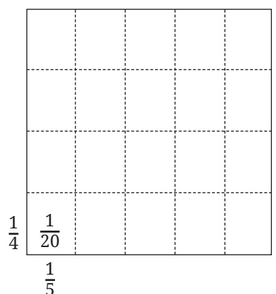

General rules for performing arithmetic operations on fractions — in essentially the modern form in which we carry them out today were first codified by Brahmagupta in his Brāhmasphuṭasiddhānta in 628 CE. We have already seen his methods for adding and subtracting general fractions. For multiplying general fractions, Brahmagupta wrote:

“Multiplication of two or more fractions is obtained by taking the product of the numerators divided by the product of the denominators.” (Brāhmasphuṭasiddhānta, Verse 12.1.3)

That is,

$$
{ \frac { a } { b } }   \times   { \frac { c } { d } }   =   { \frac { a \times c } { b \times d } } .
$$

For division of general fractions, Brahmagupta wrote:

“The division of fractions is performed by interchanging the numerator and denominator of the divisor; the numerator of the dividend is then multiplied by the (new) numerator, and the denominator by the (new) denominator.”

Bhāskara II in his book Līlāvatī in 1150 CE clarifies Brahmagupta‘s statement further in terms of the notion of reciprocal:

“Division of one fraction by another is equivalent to multiplication of the first fraction by the reciprocal of the second.” (Līlāvatī, Verse 2.3.40)

Both of these verses are equivalent to the formula:

$$
\frac{a}{b} \div \frac{c}{d} = \frac{a}{b} \times \frac{d}{c} = \frac{a \times d}{b \times c}.
$$

Bhāskara I, in his 629 CE commentary Āryabhaṭīyabhāṣhya on

Aryabhata’s 499 CE work, described the geometric interpretation of multiplication of fractions (that we saw earlier) in terms of the division of a square into rectangles via equal divisions along the length and breadth.

Many other Indian mathematicians, such as Śhrīdharāchārya (c. 750 CE), Mahāvīrāchārya (c. 850 CE), Caturveda Pṛithūdakasvāmī (c. 860 CE), and Bhāskara II (c. 1150 CE) developed the usage of arithmetic of fractions significantly further. E

Bhāskara I’s visual explanation that

The Indian theory of fractions and arithmetic operations on them was

$$
\frac { 1 } { 5 } \times \frac { 1 } { 4 } = \frac { 1 } { 2 0 }
$$

transmitted to, and its usage developed further, by Arab and African mathematicians such as al-Hassâr (c. 1192 CE) of Morocco. The theory was then transmitted to Europe via the Arabs over the next few