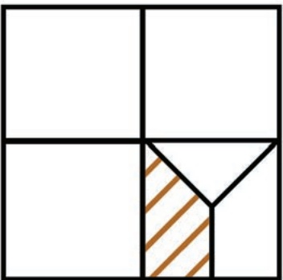

3. If $\frac { 1 } { 4 }$ kg of flour is used to make 12 rotis, how much flour is used to make 6 rotis?

4. Pāṭīgaṇita, a book written by Sridharacharya in the 9th century CE, mentions this problem: “Friend, after thinking, what sum will be obtained by adding together $1 \div \frac{1}{6}   ,   1 \div \frac{1}{10}   ,   1 \div \frac{1}{13}   ,   1 \div \frac{1}{9}$ , and $1 \div \frac{1}{2}''$ . What should the friend say?

5. Mira is reading a novel that has 400 pages. She read $\frac { 1 } { 5 }$ of the pages yesterday and $\frac { 3 } { 1 0 }$ of the pages today. How many more pages does she need to read to finish the novel?

6. A car runs 16 km using 1 litre of petrol. How far will it go using $2   \frac { 3 } { 4 }$ litres of petrol?

7. Amritpal decides on a destination for his vacation. If he takes a train, it will take him $5 \frac { 1 } { 6 }$ hours to get there. If he takes a plane, it will take him $\frac { 1 } { 2 }$ hour. How many hours does the plane save?

8. Mariam’s grandmother baked a cake. Mariam and her cousins finished $\frac{4}{5}$ of the cake. The remaining cake was shared equally by Mariam’s three friends. How much of the cake did each friend get?

9. Choose the option(s) describing the product of $\left( { \frac { 5 6 5 } { 4 6 5 } } \times { \frac { 7 0 7 } { 6 7 6 } } \right)$ (a) $>   { \frac { 5 6 5 } { 4 6 5 } }$ (b) $< \frac { 5 6 5 } { 4 6 5 }$ (c) $>   { \frac { 7 0 7 } { 6 7 6 } }$ (d) $<   \frac { 7 0 7 } { 6 7 6 }$ (e) > 1 (f) $< 1$

10. What fraction of the whole square is shaded?

