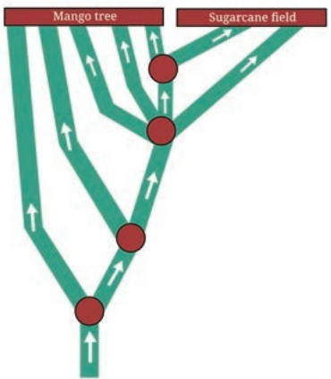

11. A colony of ants set out in search of food. As they search, they keep splitting equally at each point (as shown in the Fig. 8.7) and reach two food sources, one near a mango tree and another near a sugarcane field. What fraction of the original group reached each food source?

12. What is $1 - { \frac { 1 } { 2 } }   ?$

$$
\left( 1 - { \cfrac { 1 } { 2 } } \right) \times \left( 1 - { \cfrac { 1 } { 3 } } \right) ?
$$

Fig. 8.7

$$
\left( 1 - { \frac { 1 } { 2 } } \right) \times \left( 1 - { \frac { 1 } { 3 } } \right) \times \left( 1 - { \frac { 1 } { 4 } } \right) \times \left( 1 - { \frac { 1 } { 5 } } \right) ?
$$

$$
\left(1-\frac{1}{2}\right)\times\left(1-\frac{1}{3}\right)\times\left(1-\frac{1}{4}\right)\times\left(1-\frac{1}{5}\right)\times\left(1-\frac{1}{6}\right)\times\left(1-\frac{1}{7}\right)\times\left(1-\frac{1}{8}\right)\times\left(1-\frac{1}{9}\right)\times\left(1-\frac{1}{10}\right)^{-\frac{1}{7}}
$$

Make a general statement and explain.

## SUMMARY

• Brahmagupta’s formula for multiplication of fractions:

$$
\frac{a}{b} \times \frac{c}{d} = \frac{a \times c}{b \times d}.
$$

When multiplying fractions, if the numerators and denominators have some common factors, we can cancel them first before multiplying the numerators and denominators.

In multiplication — when one of the numbers being multiplied is between 0 and 1, the product is less than the other number. If one of the numbers being multiplied is greater than 1, then the product is greater than the other number.

The reciprocal of a fraction ${ \frac { a } { b } } \operatorname { i s } { \frac { b } { a } } .$ When we multiply a fraction by its reciprocal, the product is 1.

• Brahmagupta’s formula for division of fractions:

$$
\frac{a}{b} \div \frac{c}{d} = \frac{a}{b} \times \frac{d}{c} = \frac{a \times d}{b \times c}.
$$

In division — when the divisor is between 0 and 1, the quotient is greater than the dividend. When the divisor is greater than 1, the quotient is less than the dividend.