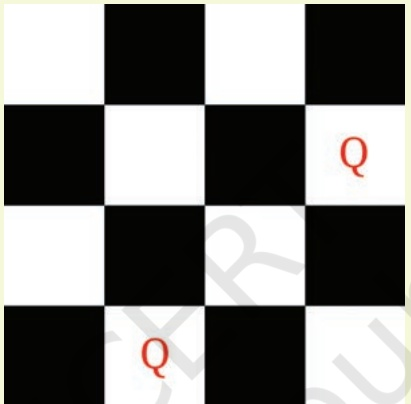
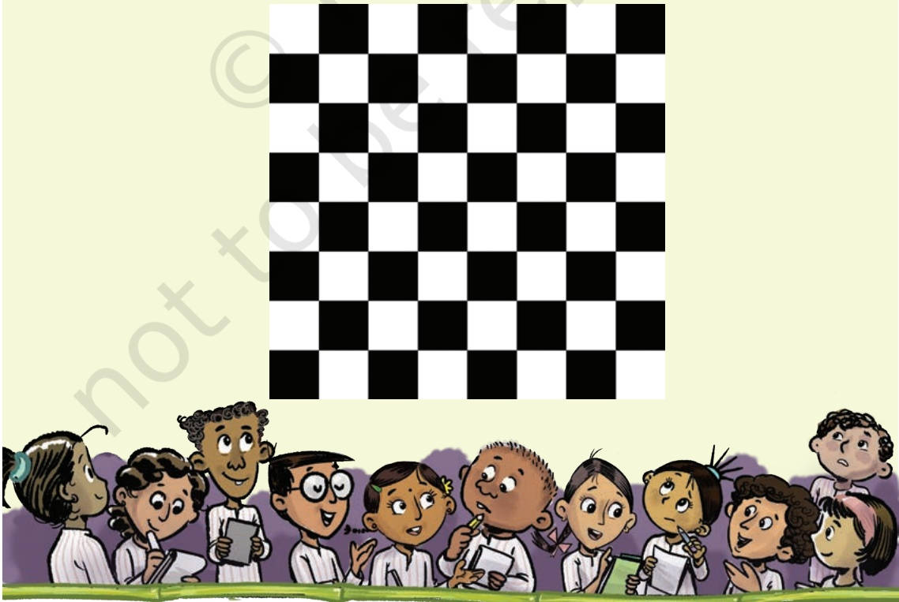

## Ii' PUZZLE TME!

Chess is a popular 2-player strategy game. This game has its origins in India. It is played on an 8 × 8 chequered grid. There are 2 sets of pieces — black and white — one set for each player. Find out how each piece should move and the rules of the game.

Here is a famous chess-based puzzle. From its current position, a Queen piece can move along the horizontal, vertical or diagonal. Place 4 Queens such that no 2 queens attack each other. For example, the arrangement below is not valid as the queens are in the line of attack of each other.

Now, place 8 queens on this 8 × 8 grid so that no 2 queens attack each other!

