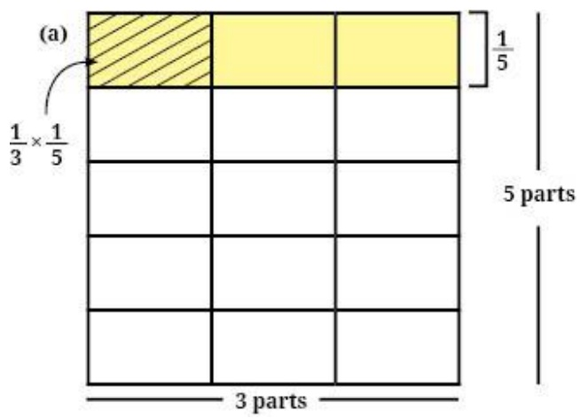

## Page No. 177

**5. Multiply and then convert it into a mixed fraction:**

(a) $7 \times \frac { 3 } { 5 }$

**Ans:** $7 \times \frac{3}{5} = \frac{21}{5} = 4\frac{1}{5}$

(b) $4 \times { \frac { 1 } { 3 } }$

**Ans:** 4 $\times \frac{1}{3} = \frac{4}{3} = 1\frac{1}{3}$

(c) $\frac { 9 } { 7 } \times 6$

9 54 5 Ans: × 6 = = 7 7 7 7

**(d)** $\frac { \mathbf { 1 3 } } { \mathbf { 1 1 } } \times \mathbf { 6 }$

$$
\frac{13}{11} \times 6 = \frac{78}{11} = 7\frac{1}{11}
$$

## Page No. 180

？ **Figure it out**

**1. Find the following products. Use a unit square as a whole for representing the fractions:**

**(a)** $\frac { 1 } { 3 } \times \frac { 1 } { 5 }$

**Ans:** $\frac { 1 } { 1 5 }$

