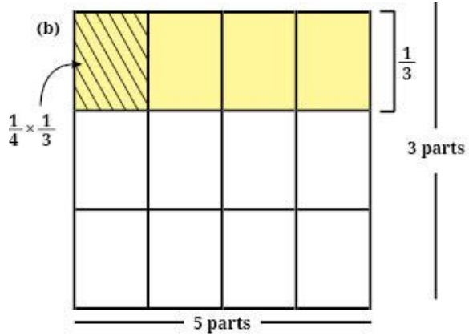
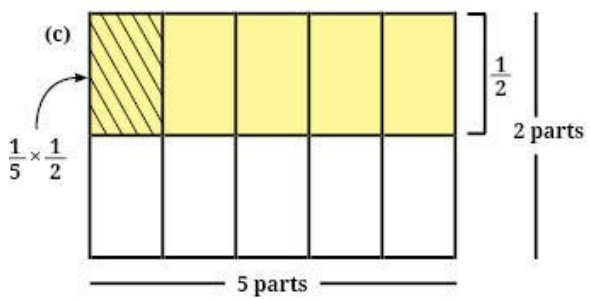
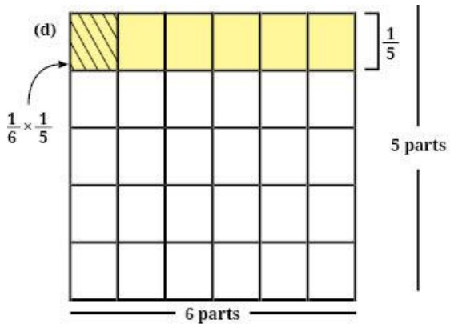

(lb) $\frac { 1 } { 4 } \times \frac { 1 } { 3 }$

Ans: $\frac { 1 } { 1 2 }$

(c) $\frac { 1 } { 5 } \times \frac { 1 } { 2 }$

Ans: $\frac { 1 } { 1 0 }$

(d) $\frac { 1 } { 6 } \times \frac { 1 } { 5 }$

Ans: $\frac { 1 } { 3 0 }$

