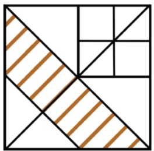
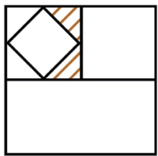

## Page No. 191

**In a day, the number of times —**

(a) the first fountain will fill the cistern is $\mathbf { 1 } { \div } \mathbf { 1 } = \mathbf { 1 }$

(b) the second fountain will fill the cistern is $1 \div \frac { 1 } { 2 } =$

**Ans:** 2 times

(c) the third fountain will fill the cistern is $1 \div   { \frac { 1 } { 4 } }   =$ **Ans:** 4 times

(d) the fourth fountain will fill the cistern is $1 \div   { \frac { 1 } { 5 } }   =$

**Ans:** 5 times

**The number of times the four fountains together will fill the cistern in** a day is ${ \bf \underline { { \quad } } } ^ { + } { \bf \underline { { \quad } } } ^ { + } { \bf \underline { { \quad } } } ^ { + } { \bf \underline { { \quad } } } ^ { + } { \bf \underline { { \quad } } } ^ { + } { \bf \underline { { \quad } } } ^ { - } { \bf \underline { { \quad } } } ^ { - } = 1 2 .$

**Ans:** The number of times the four fountains together will fill the cistern in a day is = 1 + 2 + 4 + 5 = 12

**Page No. 193**

？ **In each of the figures given below, find the fraction of the big square that the shaded region occupies.**

(a)

(b)

**Ans:** The shaded region of Fig. (a) occupies $\frac{3}{8}$ of the area of whole square. The red shaded part of Fig. (b) occupies $\frac { 1 } { 1 6 }$ of the area of whole square.