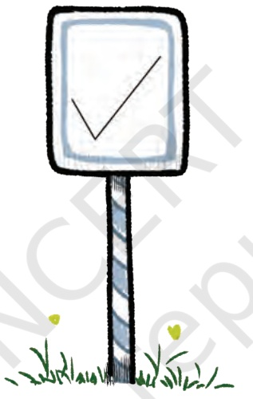
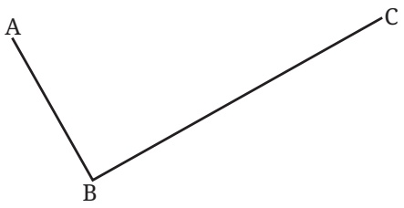

0789CH01

## 1.1 Geometric Twins

The symbol on this signboard needs to be recreated on another board.

## How do we do it?

One way is to trace the outline of this symbol on tracing paper to reconstruct the figure. But this is difficult for big symbols. What else can we do?

？ Can we take some measurements that would allow us to exactly recreate this figure? If yes, what measurements should we take?

Let us name the corner points of this symbol as shown.

Are the arm lengths AB and BC sufficient to exactly recreate this figure?