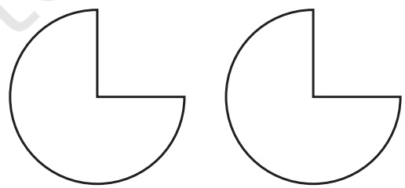
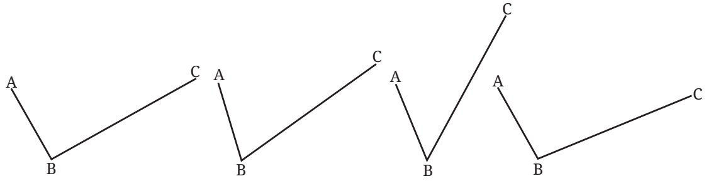
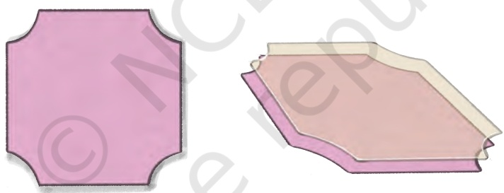

Suppose these lengths are AB = 4 cm, BC = 8 cm. We observe that several such symbols can be constructed with the same lengths.

To get the exact replica, would it help to take any other measurement?

The measure of $\angle  ABC ,$ the shape and size of this figure.

？ Can you draw the symbol if it is known that AB = 4 cm, BC = 8 cm, and $\angle ABC = 80^{\circ}?$

These three measurements can help us create an exact replica of the symbol on the signboard. Figures that are exact copies of each other or have the same shape and size are said to be **congruent**. Congruent figures can be superimposed exactly, one over the other.

Two congruent figures are shown below. You could use a tracing paper to trace the first figure and superimpose it on the second one. You will find that they fit exactly, one over the other.

Note that while checking for congruence, a figure can be rotated or flipped before superimposing it on the other figure. So, the following pairs of figures are also congruent to each other.