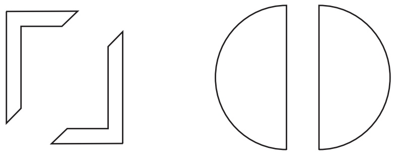
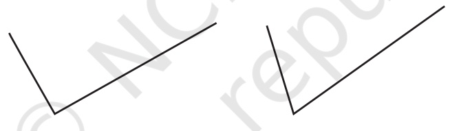
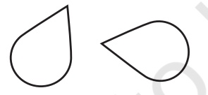
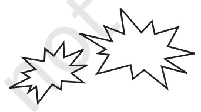

Let us get back to the symbol we saw on the signboard. Suppose there are two such symbols that look identical and we need to confirm that they are indeed congruent. Can we use their measurements to verify this?

? If it is known that both symbols have the same arm lengths, can it be concluded that the two symbols are congruent?

We have seen that there can exist several such non-congruent figures with different angles between the given arm lengths. Fixing the angle determines the shape and size of the figure.

Thus, if both symbols have the same arm lengths and angle, we can be sure that the figures are congruent.

## Figure it Out

1. Check if the two figures are congruent.

2. Circle the pairs that appear congruent.

3. What measurements would you take to create a figure congruent to a given:

(a) Circle

(b) Rectangle