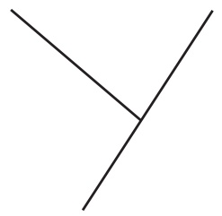
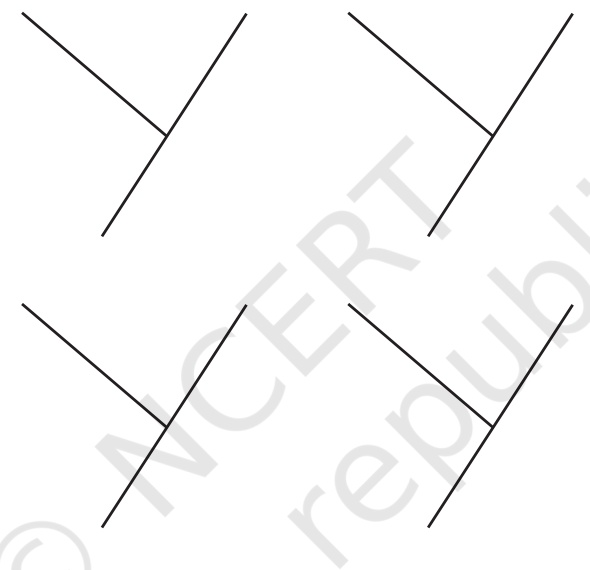

Using this, state how would you check if two —

(a) Circles are congruent?

(b) Rectangles are congruent?

4. How would we check if two figures like the one below are congruent?

Use this to identify whether each of the following pairs are congruent.

## 1.2 Congruence of Triangles

Meera and Rabia have been asked to make a cardboard cutout identical to a triangular frame they have in school. They see that the frame is too big to be traced on a paper and replicated.

