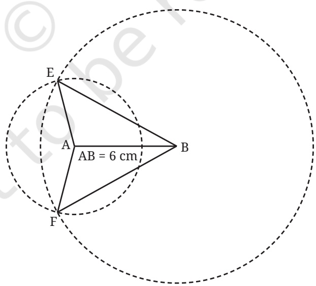

## What do you think they can do?

## Measuring the Sidelengths

Can certain measurements of the triangle be used for this? Using a measuring tape, the girls measure the sides of the triangle to be 40 cm, 60 cm, and 80 cm.

Then, Rabia takes out her protractor to measure the angles. She is stopped by Meera.

**Meera:** The angles of the triangle are not required! With the side lengths we have measured, we can create a triangle congruent to this one.

## Do you agree with Meera?

？ Instead of the lengths being 40 cm, 60 cm, and 80 cm, suppose the sidelengths had been 4 cm, 6 cm, 8 cm (this triangle can fit on our page).

？ Is this information sufficient to replicate the triangle with the same size and shape? If yes, can you do so?

**Rabia:** If I were to construct this triangle, I would first draw a line segment having one of the given lengths, say 6 cm, and then draw circles from each of its end points with radii 4 cm and 8 cm. But the circles would intersect at two points, forming two triangles: ∆ABE and ∆ABF

**Rabia:** Do these two triangles have the same shape and size? If not, then we will not be sure which of these would actually be congruent to the original triangle we are trying to replicate.