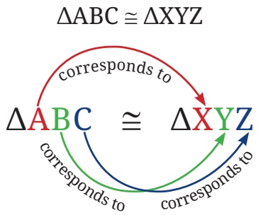
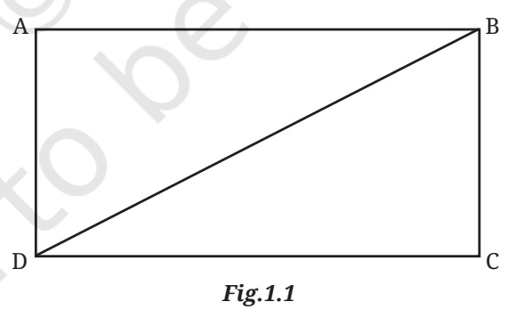

(b) Corresponding Sides: AB and XY, BC and YZ, AC and XZ

(c) Corresponding Angles: $\angle \mathrm { A }$ and $\angle \mathrm { X } , \angle \mathrm { B }$ and $\angle \mathrm { Y } , \angle \mathrm { C }$ and $\angle \mathrm { Z }$

To capture this relation that exists when two triangles are congruent, their congruence is written as follows:

By writing this, we mean that:

the first vertex in the name of ΔABC corresponds to the first vertex in the name of ΔXYZ,

the second vertex in the name of $\Delta \mathrm { A B C }$ corresponds to the second vertex in the name of ΔXYZ, and

• similarly with the third vertices in the names of ΔABC and ΔXYZ.

By this convention, it is **incorrect** to write for these two triangles that ΔACB ≅ ΔXYZ.

However, another correct way of saying it is

$$
\Delta  ACB  \cong \Delta  XZY.
$$

？ Can you identify a pair of congruent triangles below? Why are they congruent?

Consider $\Delta \mathrm { A B D }$ and ΔCDB. Since ABCD is a rectangle, we have

$$
\mathrm{AB} = \mathrm{CD}
$$

$$
\mathrm{AD} = \mathrm{CB}
$$

If the remaining sides of ΔABD and ΔCDB have the same length then the SSS condition is satisfied, confirming the congruence of the two triangles. Is this the case?