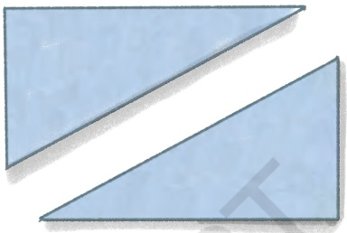
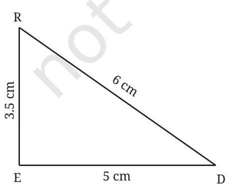
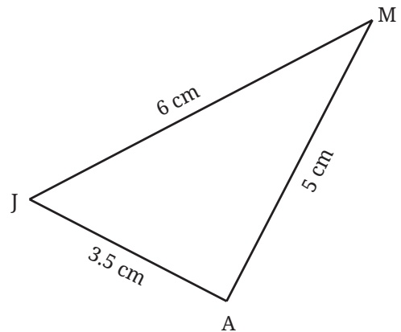

The remaining side is a common side BD, so the SSS condition holds. Hence, the triangles are congruent.

We know the corresponding sides of the two triangles. We have to identify the corresponding vertices. Can they be the following?

ΔABD ΔCDB A C B B D D

？ Verify this by superimposing paper cutouts of the triangles obtained from the rectangle ABCD (Fig. 1.1).

We see that this correspondence lays the side AB of ΔABD over the side CB of ΔCDB. But these sides need not be equal, and hence, this superimposition will not establish congruence.

Identify the correct correspondence of vertices and express the congruence between the two triangles.

## Figure it Out

1. Suppose ΔHEN is congruent to ΔBIG. List all the other correct ways of expressing this congruence.

2. Determine whether the triangles are congruent. If yes, express the congruence.

