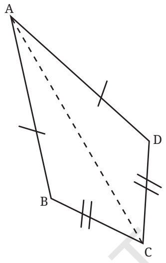
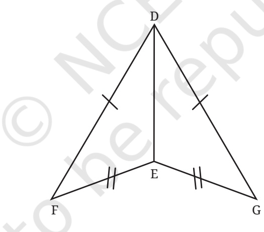

3. In the figure below, $AB = AD, CB = CD.$

Can you identify any pair of congruent triangles? If yes, explain why they are congruent.

Does AC divide $\angle  BAD$ and $\angle  BCD$ into two equal parts? Give reasons.

4. In the figure below, are ΔDFE and ΔGED congruent to each other? It is given that $\mathrm { D F } = \mathrm { D G }$ and $\mathrm{FE} \equiv \mathrm{GE}.$

## Measuring the Angles

Instead of measuring the three sidelengths of the triangular frame, if Meera and Rabia measure the three angles, can they recreate the triangle exactly?

？ Suppose the angles are 30°, 70°, and $8 0 ^ { \circ } .$ Can we create an exact copy of the frame with this?

As we see, we can draw many triangles with these measurements that are not congruent.