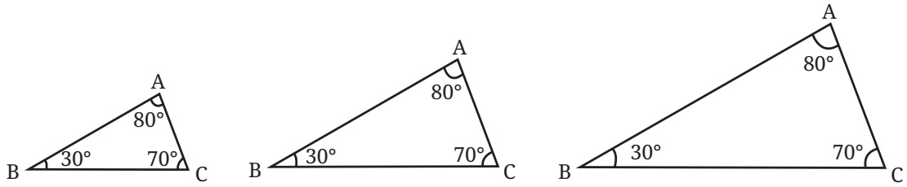

These triangles are seen to have the same shape, but not the same size. Hence, two triangles that have the same set of angles need not be congruent.

## Measuring Two Sides and the Included Angle

ΔABC and ΔXYZ are two triangles such that

$$
AB = XY = 6\  cm , AC = XY = 5\  cm , and \angle A = \angle X = 30^{\circ}
$$

Are they congruent?

To check this, we need to see if there can exist non-congruent triangles with the given measurements.

These measurements correspond to the case of two sides and the included angle. We have seen how to construct a triangle given these measurements.

? Construct a triangle having the above measurements.

Compare it with the triangles constructed by your classmates. Are the triangles all congruent? Explain why all such triangles with these measurements are congruent.

Thus, when two sides and the included angle of two triangles are equal, the two triangles are congruent.

This is referred to as the **SAS (Side Angle Side)** condition for congruence.

## Measuring Two Sides and a Non-included Angle

What if two sides and a non-included angle are equal?

ΔABC and ΔXYZ are two triangles such that

$$
AB = XY = 6\  cm , AC = XY = 4\  cm , and \angle B = \angle Y = 30^{\circ}
$$

Are they congruent?

？ Can there exist non-congruent triangles having these measurements? Construct and find out.