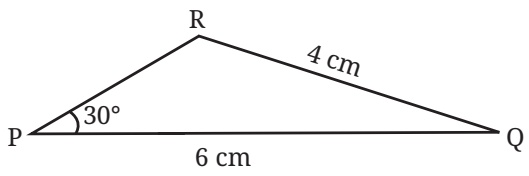
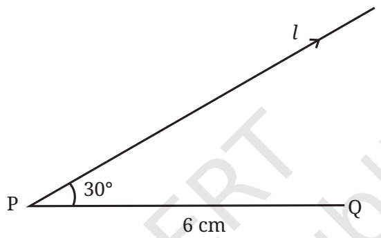
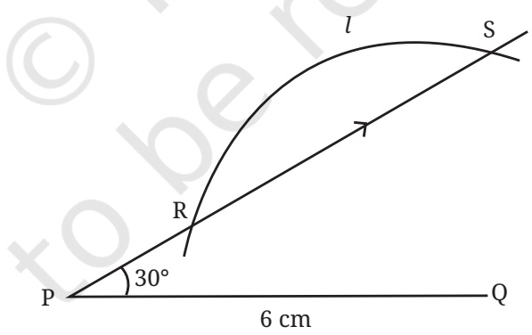

Looking at a rough diagram helps in planning the construction.

How does one construct a triangle having these measurements?

**Step 1:** Draw the base PQ of length 6 cm.

**Step 2:** Draw a line l from P that makes an angle of $3 0 ^ { \circ }$ with PQ.

**Step 3:** Draw a sufficiently long arc from line l.

？ How do we find the required triangle from this figure?

A point of intersection of the arc and the line l gives the third point of the required triangle. But we see that the arc intersects the line l at two different points R and S.

Both ΔPQR and ΔPQS satisfy the given measurements.