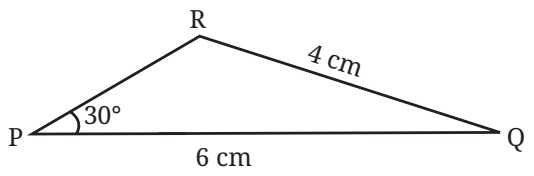
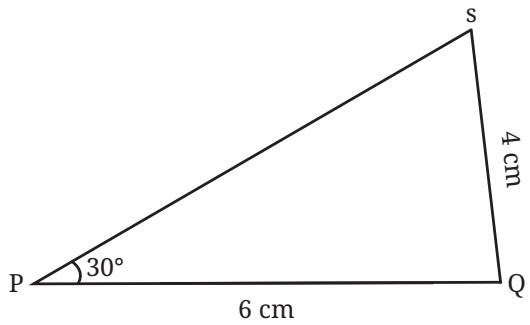
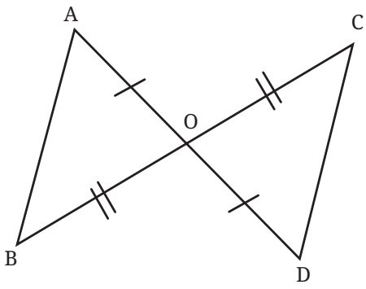

Hence, we can draw two non-congruent triangles with the given measurements.

This is called the **SSA (Side Side Angle)** condition. We have seen that SSA condition **does not guarantee** congruence.

congruence. Can we use two angles and a side?

Let us first take the case of two angles and the included side.

## Two Angles and the Included Side

ΔABC and ΔXYZ are two triangles with,

$$
\mathrm{BC} = \mathrm{YZ} = 5\ \mathrm{cm}, \angle \mathrm{B} = \angle \mathrm{Y} = 50^{\circ}\ \mathrm{and}\ \angle \mathrm{C} = \angle \mathrm{Z} = 30^{\circ}.
$$

Are they congruent?

？ Can there exist non-congruent triangles having these measurements? Construct and find out.

We have seen how to construct a triangle when we are given two angles and the included side.

This construction should make it clear that all the triangles having these measurements must be congruent to each other. Hence, $\Delta \mathrm { A B C } \cong \Delta \mathrm { X Y Z } .$

This condition is referred to as the **ASA (Angle Side Angle)** condition for congruence.

？ In the figure, Point O is the midpoint of AD and BC. What can one say about the lengths AB and CD?

