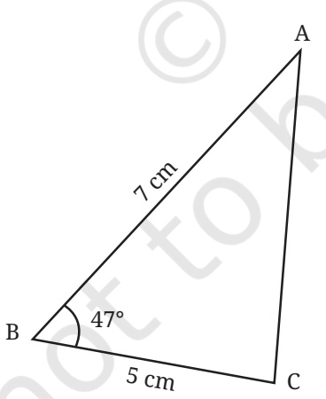
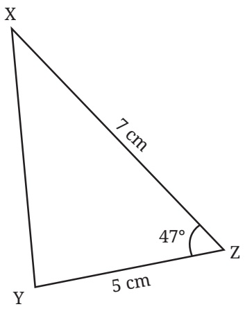

We have,

AO = OD (as O is the midpoint of AD)

BO = OC (as O is the midpoint of BC).

## Are there any other equal sides or angles?

We also have,

$\angle AOB = \angle DOC ,$ as they are vertically opposite angles.

We see that the SAS condition (two sides and the included angle) is satisfied, and so we can conclude that the triangles are congruent.

## What are the Corresponding Vertices?

As we need AO and OD to overlap, and BO and CO to overlap for the triangles to exactly fit over each other, the corresponding vertices in ΔAOB and ΔDOC are A and D, O and O (vertex common to both the triangles), and B and C. Thus,

$$
\Delta  AOB  \cong \Delta  DOC .
$$

AB and DC are corresponding sides as they overlap when the triangles are superimposed. Thus, their lengths are equal.

## Figure it Out

1. Identify whether the triangles below are congruent. What conditions did you use to establish their congruence? Express the congruence.

2. Given that CD and AB are parallel, and $\mathrm{AB} = \mathrm{CD}_{:}$ , what are the other equal parts in this figure? (**Hint:** When the lines are parallel, the alternate angles are equal. Are the two resulting triangles congruent? If so, express the congruence.)