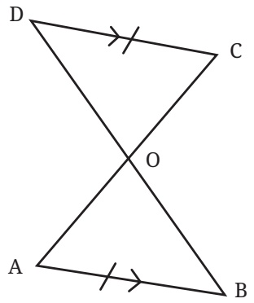
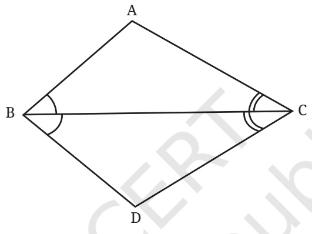
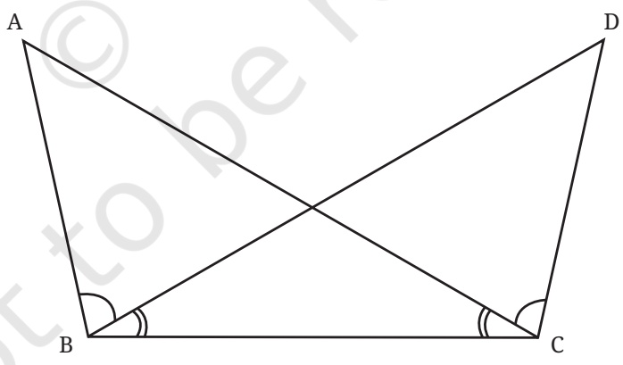

3. Given that $\angle ABC = \angle DBC$ and $\angle ACB = \angle DCB$ , show that $\angle BAC = \angle BDC.$ Are the two triangles congruent?

4. Identify the equal parts in the following figure, given that $\angle ABD =$ ∠DCA and $\angle ACB = \angle DBC$

**Measuring Two Angles and a Non-Included Side**

？ The following triangles $\Delta \mathrm { A B C }$ and ΔXYZ are such that $\angle \mathrm{A} = \angle \mathrm{X} = 35^{\circ}$ $\angle C = \angle Z = 75^{\circ}$ , and $\mathrm{BC} = \mathrm{YZ} = 4$ cm. Are the triangles congruent? Give a reason.